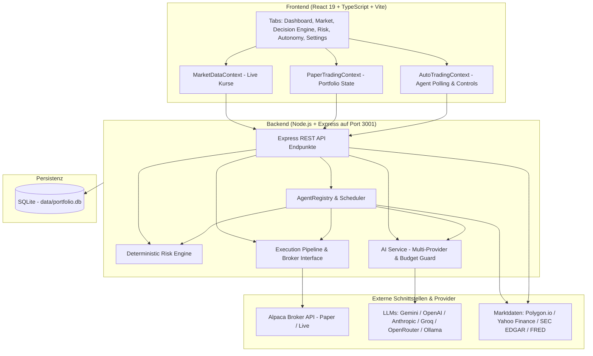
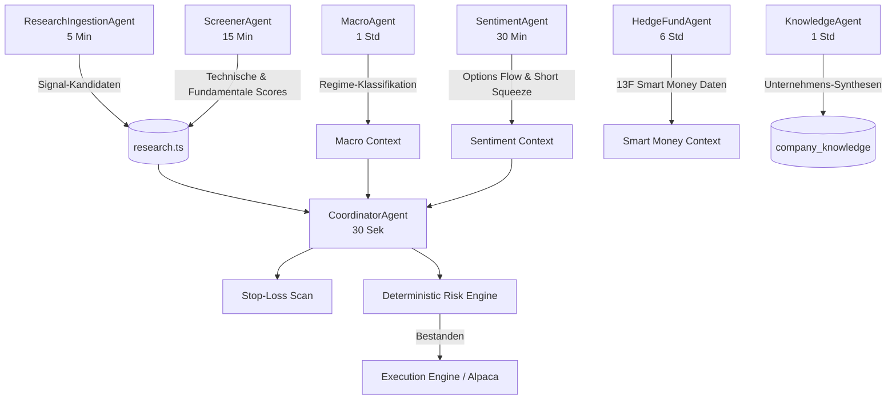
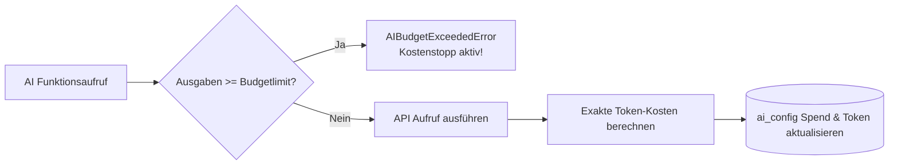
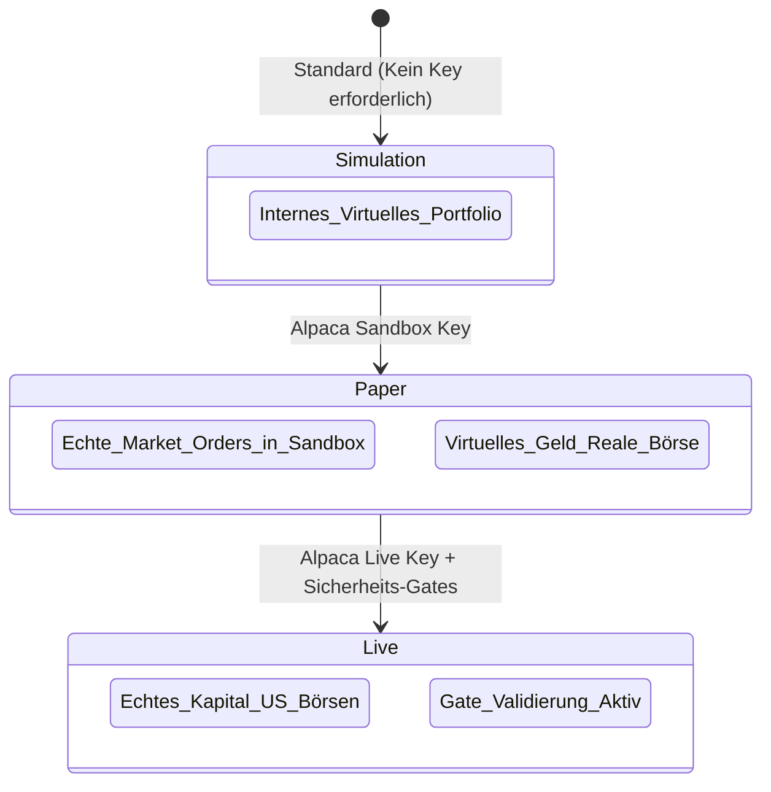
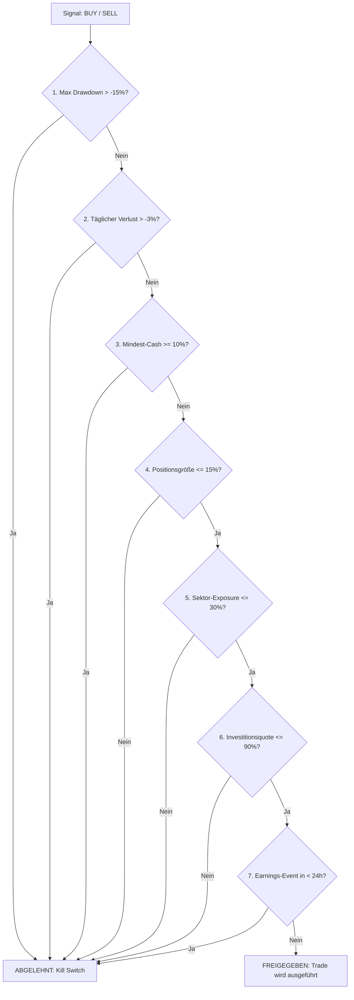

# Autonome Portfolio-Management Plattform — Umfassende Dokumentation

Eine moderne, KI-gesteuerte Handels- und Portfolio-Management-Plattform für autonome und semi-autonome Anlagestrategien in US-Tech-Aktien. Die Plattform verbindet Multi-Agenten-Architektur, deterministische Risiko-Engines, Live-Marktdaten, modernste Large Language Models (LLMs) und echte Broker-Anbindungen (Alpaca).

---

## Inhaltsverzeichnis

1. [Plattform-Übersicht & Philosophie](#1-plattform-übersicht--philosophie)
2. [Gesamtarchitektur & Tech-Stack](#2-gesamtarchitektur--tech-stack)
3. [Multi-Agenten-System](#3-multi-agenten-system)
4. [KI-Engine & Multi-Provider-Integration](#4-ki-engine--multi-provider-integration)
5. [Globales KI-Budget & Kostenstopp](#5-globales-ki-budget--kostenstopp)
6. [Broker-Integration & Execution Pipeline](#6-broker-integration--execution-pipeline)
7. [Deterministische Risiko-Engine & Sicherheits-Gates](#7-deterministische-risiko-engine--sicherheits-gates)
8. [Daten-Module & Marktdaten-Pipeline](#8-daten-module--marktdaten-pipeline)
9. [Benutzeroberfläche & Feature-Module (Tabs)](#9-benutzeroberfläche--feature-module-tabs)
10. [Datenbank-Architektur & Persistenz](#10-datenbank-architektur--persistenz)
11. [Installation, Setup & Betrieb](#11-installation-setup--betrieb)
12. [Wichtige API-Endpunkte](#12-wichtige-api-endpunkte)

---

## 1. Plattform-Übersicht & Philosophie

Die Plattform ist darauf ausgelegt, die Analyse, Entscheidungsfindung und Ausführung von Wertpapiertransaktionen vollautomatisch durchzuführen, ohne menschliche Bauchentscheidungen vorauszusetzen — jedoch unter **strengen mathematischen und deterministischen Risikokontrollen**.

### Kernprinzipien:
- **Autonome Intelligenz**: Mehrere spezialisierte KI-Agenten analysieren simultan Marktstimmung, Fundamentaldaten, Makroökonomie, SEC-Filings (13F, 8-K, Form 4 Insiderkäufe) und technische Indikatoren.
- **Deterministische Sicherheit**: Kein KI-Modell darf direkt unkontrolliert Aufträge abschicken. Jede Order muss zwingend 7 harte Risiko- und Portfolio-Filter durchlaufen.
- **Transparenz & Decision Lineage**: Jede Trade-Entscheidung speichert ihre vollständige Begründung (These, Signal-Score, Makro-Regime, Konfidenz) in der Datenbank ab.
- **Provider-Unabhängigkeit**: Volle Wahlfreiheit zwischen Google Gemini, OpenAI, Anthropic, Groq, OpenRouter oder lokalem Ollama inklusive dynamischem Modell-Laden und globalem Budget-Schutz.
- **Multi-Modus-Brokerage**: Nahtloser Wechsel zwischen rein lokaler Simulation, Alpaca Paper-Trading (Sandbox) und Alpaca Live-Trading (Echtgeld).

---

## 2. Gesamtarchitektur & Tech-Stack

Die Anwendung besteht aus einem modernen **Frontend (Single Page Application)** und einem **robusten Node.js / Express Backend**, verbunden über eine REST-API und optimierte Event-Polling-Zyklen.



### Technische Komponenten:
- **Frontend**: React 19, TypeScript, Vite, Tailwind CSS v4, Lucide Icons, Recharts, Radix UI Primitives, Motion.
- **Backend**: Node.js, Express, TypeScript (`tsx`), `better-sqlite3`.
- **Datenbank**: SQLite (`data/portfolio.db`) mit WAL-Modus für maximale Lese-/Schreib-Performance ohne Locks.
- **Broker-Protokoll**: Alpaca Trading API SDK mit Order-Reconciliation, Fill-Analytics und Slippage-Messung.

---

## 3. Multi-Agenten-System

Das Herzstück der Entscheidungsfindung ist ein asynchrones Multi-Agenten-System (`server/agents/`), bei dem jeder Agent von der Basisklasse `BaseAgent` (`server/agents/base.ts`) erbt.



### Übersicht der Agenten:

| Agent | Intervall | Hauptaufgabe |
|---|---|---|
| **`CoordinatorAgent`** | 30 s | Orchestriert den gesamten Trade-Zyklus: Führt Stop-Loss-Scans durch, prüft Risikolimits und verarbeitet qualifizierte Signal-Kandidaten aus der Research-Queue zu konkreten Orders. |
| **`ResearchIngestionAgent`** | 5 min | Liest RSS-News (Yahoo Finance etc.), ruft LLM-Analysen ab, bewertet Relevanz, Sentiment und Zeithorizont und erzeugt formatierte Signal-Kandidaten. |
| **`ScreenerAgent`** | 15 min | Berechnet Scorecards für alle Watchlist-Aktien basierend auf technischen Indikatoren (RSI, MACD, Trend) und Bewertungskennzahlen (KGV, Umsatzwachstum). |
| **`SentimentAgent`** | 30 min | Analysiert Options-Flow (Put/Call-Verhältnisse), Short Interest und potenzielle Squeeze-Setups über externe Schnittstellen. |
| **`MacroAgent`** | 1 h | Aggregiert makroökonomische Daten (Federal Reserve Leitzinsen, CPI-Inflation, Arbeitsmarktdaten) und klassifiziert das aktuelle Makro-Regime (z. B. *Expansion*, *Slowdown*, *Stagflation*). |
| **`KnowledgeAgent`** | 1 h | Konsolidiert historische Analysen, SEC-Filings und Quartalszahlen pro Aktie zu einer kontinuierlichen KI-Wissensbasis (`company_knowledge`). |
| **`HedgeFundAgent`** | 6 h | Liest SEC 13F-Einreichungen institutioneller Großanleger (Buffett, Dalio, Scion, etc.) aus und identifiziert Smart-Money-Akkumulationen. |

---

## 4. KI-Engine & Multi-Provider-Integration

Das System ist vollständig herstellerunabhängig (`server/aiService.ts`). Über die Einstellungen kann zur Laufzeit zwischen 6 führenden KI-Plattformen gewechselt werden:

### Unterstützte Provider & Flaggschiff-Modelle:

1. **Google Gemini**:
   - `gemini-2.5-flash`: Ultraschnelles DeepMind-Flaggschiff für Streaming & schnelle Ingestion.
   - `gemini-2.5-pro`: Hochentwickeltes Reasoning für komplexe Quartalsberichte und tiefe Portfolio-Thesen.
   - `gemini-2.0-flash` & `gemini-2.0-flash-lite`: Kosteneffiziente Multimodal-Modelle.
2. **OpenAI**:
   - `gpt-4o` & `gpt-4o-mini`: Industriestandard für multimodale Analyse.
   - `o3-mini`: Neuestes High-Speed Reasoning-Modell für quantitative Logik.
   - `o1` & `o1-mini`: Tiefgehende logische Denkketten.
   - `gpt-4.5-preview`: Großes Flaggschiff-Modell.
3. **Anthropic**:
   - `claude-3-7-sonnet-latest` (bzw. `claude-3-7-sonnet-20250219`): Modernstes Modell mit Hybrid-Reasoning und überragender Code- und Finanzanalyse.
   - `claude-3-5-sonnet-latest`: Bewährter Benchmark für strukturierte Datenextraktion.
   - `claude-3-5-haiku-latest`: Extrem schnell für Echtzeit-Nachrichtenfilterung.
4. **Groq Cloud**:
   - `deepseek-r1-distill-llama-70b`: LPU-beschleunigtes Open-Weights Reasoning mit extrem niedriger Latenz.
   - `llama-3.3-70b-versatile`: Offenes Spitzenmodell mit 128k Kontext.
   - `qwen-qwq-32b`: Alibabas Reasoning-Modell.
5. **OpenRouter**:
   - Universeller Zugriff auf Hunderte Modelle (`anthropic/claude-3.7-sonnet`, `deepseek/deepseek-r1`, etc.) über einen zentralen API-Key.
6. **Ollama (Lokal)**:
   - 100 % private und kostenfreie Ausführung auf eigener Hardware via `http://localhost:11434` (z. B. `deepseek-r1:latest`, `llama3.3:latest`).

### Dynamisches Auto-Loading & Manuelle Eingabe:
- Beim Klick auf einen Provider fragt das Backend in Echtzeit die offizielle Modell-API des Anbieters ab.
- Die Modelle werden nach Leistungsfähigkeit sortiert im Dropdown bereitgestellt.
- Über die Schaltfläche **„Eigenes Modell eingeben“** kann jederzeit jeder beliebige Modell-Name (z. B. eigene Fine-Tunings oder Preview-Releases) von Hand eingetragen werden.
- Über **„Verbindung testen“** wird ein Latenz- und Validierungs-Check durchgeführt, der sofort Feedback über Status und Antwortzeit in Millisekunden liefert.

---

## 5. Globales KI-Budget & Kostenstopp

Um unkontrollierte API-Kosten durch automatisierte Hintergrundprozesse auszuschließen, verfügt die Plattform über einen **deterministischen Budget-Wächter** (`server/aiService.ts`):



### Funktionsweise:
- **Einstellbares Limit**: In den Einstellungen kann ein globales Budget in USD (z. B. 10.00 $) hinterlegt werden.
- **Echtzeit-Tokenberechnung**: Bei jeder API-Antwort werden Eingabe- und Ausgabe-Tokens ausgelesen und anhand einer detaillierten Preistabelle (`PRICING_PER_1M`) minutengenau berechnet.
- **Deterministischer Block**: Sobald die Gesamtausgaben das Budget erreichen oder überschreiten, wird das Flag `budget_blocked = 1` gesetzt und jede weitere KI-Anfrage mit einem `AIBudgetExceededError` abgefangen.
- **Transparente UI**: Eine Fortschrittsanzeige visualisiert verbrauchtes Budget, verbleibendes Restbudget und Tokenanzahl. Bei Erreichen des Limits erscheint ein deutlicher Warnbanner mit einem 1-Klick-Reset-Button.

---

## 6. Broker-Integration & Execution Pipeline

Die Plattform unterstützt drei Betriebsmodi für die Auftragsabwicklung (`server/broker.ts`):



### Die 3 Modi im Detail:
1. **Simulation (Lokal)**: Standardmäßig aktiv. Kein externer Account erforderlich. Das Portfolio wird vollständig in SQLite simuliert (Standard: $100.000 Startkapital).
2. **Alpaca Paper Trading**: Kostenlose Sandbox-Umgebung mit echten Live-Marktzeiten und Orderbuch-Simulationen ohne finanzielles Risiko.
3. **Alpaca Live Trading**: Echter Wertpapierhandel mit realem Kapital. Streng geschützt durch Sicherheits-Gates.

### Execution Quality & Order Reconciliation:
- **ExecutionAttempt Lifecycle**: Jede Order wird über die Phasen `created` → `submitted` → `filled` / `failed` getrackt.
- **Slippage-Tracking**: Vergleich des erwarteten Preises mit dem tatsächlichen Ausführungspreis (`filledAvgPrice`).
- **Recovery beim Neustart**: Sollte der Server während einer offenen Order neustarten, gleicht `server/recovery.ts` offene Orders beim Booten automatisch mit Alpaca ab.

---

## 7. Deterministische Risiko-Engine & Sicherheits-Gates

Bevor ein Trade ausgeführt wird, validiert die Risiko-Engine (`server/risk.ts`) **7 harte, unumstößliche Regeln**:



### Die 7 deterministischen Prüfungen:
1. **Portfolio Kill Switch**: Bei einem kumulierten Portfolio-Drawdown von mehr als -15 % wird jeglicher Handel sofort gestoppt.
2. **Tägliches Verlustlimit**: Wenn das Portfolio innerhalb eines Tages mehr als -3 % verliert, werden für diesen Handelstag keine neuen Positionen eröffnet.
3. **Liquiditätsreserve**: Mindestens 10 % des Gesamtportfolios müssen immer als Cash vorgehalten werden.
4. **Maximale Positionsgröße**: Keine Einzelaktie darf mehr als 15 % des Portfoliowerts ausmachen.
5. **Sektorkonzentration**: Kein Marktsektor (z. B. Halbleiter, Software) darf mehr als 30 % des Portfolios binden.
6. **Maximale Investitionsquote**: Maximal 90 % des Kapitals dürfen in Aktien investiert sein.
7. **Earnings-Proximity-Schutz**: 1 Tag vor offiziellen Quartalszahlen gilt ein striktes Kaufverbot; 3 Tage vorher erfolgt eine Warnung.

### Live-Readiness-Gates (`server/readiness.ts`):
Bevor der Schalter für echtes Geld (`liveExecutionAllowed`) im System aktiviert werden kann, müssen folgende Bedingungen erfüllt sein:
- Mindestens 28 Tage Paper-Trading-Historie ohne signifikante Systemausfälle.
- Keine kritische Datenquellen-Degradation (`server/ops.ts`).
- Notfall-Kill-Switch gelöst.
- Aktive und verifizierte Broker-Verbindung.

---

## 8. Daten-Module & Marktdaten-Pipeline

Die Plattform nutzt eine mehrschichtige Datenarchitektur mit automatischen Fallbacks:

| Modul | Primärquelle | Fallback | Bereitgestellte Daten |
|---|---|---|---|
| **Live-Preise** | Polygon.io API (15s Cache) | Yahoo Finance / Stored EOD | Realtime Bid/Ask, Tageshochs/Tiefs, Volumen |
| **Technische Indikatoren** | Yahoo Finance v8 | SQLite History | EMA 20/50/200, RSI(14), MACD, Bollinger Bands, ATR, Volume Ratio |
| **Fundamentaldaten** | SEC EDGAR API | Yahoo Finance | EPS, Umsatz, Net Income, KGV, 52-Wochen-Range |
| **SEC-Filings** | SEC EDGAR (`sec-api.io`) | RSS Feed | 8-K (Wesentliche Ereignisse), 10-Q (Quartalsberichte), 10-K (Jahresberichte) |
| **Insider-Transaktionen** | SEC Form 4 | Public Scraper | Käufe und Verkäufe durch Vorstände, Direktoren und 10%-Eigentümer |
| **Smart Money** | SEC Form 13F | Whalewisdom / SEC | Institutionelle Großpositionen, Zu- und Verkäufe bekannter Hedgefonds |
| **Makro-Ökonomie** | FRED (St. Louis Fed) | Yahoo Macro Indices | Fed Funds Rate, US 10Y Yield, CPI Inflation, VIX Volatilitätsindex |
| **Marktuhr / Session** | Lokale Systemzeit | NY-Börsenkalender | Pre-Market, Regular Market, After-Hours, Closed |

---

## 9. Benutzeroberfläche & Feature-Module (Tabs)

Die Web-Applikation gliedert sich in 10 spezialisierte Bereiche:

### 1. Dashboard
- Gesamtwert, Cash-Bestand, Realisierter & Unrealisierter P&L.
- Interaktiver Portfolio-Performance-Chart über Zeit.
- Asset-Allokation nach Einzeltiteln und Sektoren.
- Direkte Übersicht aller offenen Positionen mit Stop-Loss-Marken.

### 2. Market Monitor
- Detaillierte Ansicht der Watchlist-Aktien (AAPL, MSFT, NVDA, GOOGL, AMZN, META, TSLA, AMD, INTC, CRM, QCOM).
- Live-Kerzencharts und umschaltbare Zeiträume.
- Automatisch berechnete technische Indikatoren (RSI, Trendsignale, Volatilität).

### 3. Decision Engine
- Transparente Einsicht in alle KI-generierten Handlungsempfehlungen.
- Detaillierte Thesen-Karten mit Kauf-/Verkauf-Begründung, Konfidenz-Scores und Signal-Historie.
- Historie aller abgelehnten Signale mit genauer Angabe des gescheiterten Risiko-Checks.

### 4. Risk Controls
- Live-Matrix der 7 Risiko-Prüfungen.
- Grafische Balken für Sektor-Exposure und maximale Positionsgrößen.
- Roter **Notfall-Kill-Switch-Button** zum sofortigen Abbruch aller Aktivitäten und optionalen Schließen aller Positionen.

### 5. Execution Log
- Vollständiges Audit-Log aller Transaktionsversuche.
- Aufschlüsselung von Slippage, Ausführungszeiten (Latenz in ms) und Broker-Rückmeldungen.
- Filterbar nach Status (Filled, Rejected, Pending).

### 6. Smart Money
- Tracking von institutionellen Investoren auf Basis neuester SEC 13F-Filings.
- Darstellung von Manager-Overlap (welche Top-Investoren kaufen dieselben Aktien?).
- Akkumulations- und Distributions-Signale von Großanlegern.

### 7. Autonomy
- Kontrollzentrum des Multi-Agenten-Netzwerks.
- Status, letzte Laufzeit und nächster geplanter Lauf jedes einzelnen Agenten.
- Live-Stream der Agenten-Beobachtungen (*Observations*) und Portfolio-Absichten (*Intents*).
- **Decision Lineage**: Vollständige Nachvollziehbarkeit, welcher Agent zu welchem Trade beigetragen hat.

### 8. Backtest
- Historischer Strategie-Simulator auf Basis gespeicherter Tageskurse.
- Konfigurierbare Zeitfenster, Startkapital und Strategie-Parameter.
- Kennzahlen: Sharpe Ratio, Max Drawdown, Win Rate, Profit Factor.

### 9. Reports
- Automatisierte Tages- und Wochenberichte.
- Performance-Attribution (welche Trades haben die Gewinne/Verluste erzielt).
- Zusammenfassung makroökonomischer Entwicklungen und Portfoliorisiken.

### 10. Settings (Einstellungen)
- **Alpaca Broker Konfiguration**: Umschalten zwischen *Simulation*, *Paper* und *Live*, Eingabe von API Key ID & Secret, Verbindungstest, Live-Account-Saldo und offene Orders.
- **KI-Provider & Modell-Auswahl**: Auswahl zwischen 6 Anbietern, dynamisches Laden der Modelle, manuelle Modell-Eingabe, API-Key-Hinterlegung und Latenztest.
- **Globales AI-Budget**: Eingabe des Höchstbetrags in USD, Fortschrittsbalken, Token-Zähler und Reset-Button.
- **Readiness-Gates & Rollout-Profile**: Profile *Paper*, *Limited Live* und *Full Live* steuern.
- **Agenten-Steuerung**: Einzelne Agenten manuell starten, stoppen oder pausieren.

---

## 10. Datenbank-Architektur & Persistenz

Alle Daten werden persistent in `data/portfolio.db` gespeichert. 

### Wichtige Datenbanktabellen:

| Tabelle | Inhalt & Zweck |
|---|---|
| `ai_config` | Speichert gewählten KI-Provider, aktives Modell, API-Keys (verschlüsselt/gemapped), globales Budgetlimit, Gesamtausgaben, Token-Zähler und Block-Status. |
| `ai_usage_logs` | Audit-Trail jedes einzelnen KI-Aufrufs mit Tokenverbrauch, Berechnungsdauer (ms), geschätzten Kosten in USD und Erfolgsstatus. |
| `broker_config` | Speichert Broker-Handelsmodus (`simulation`, `paper`, `live`), verschlüsselte API-Keys und Secrets. |
| `companies` | Stammdaten der 11 Watchlist-Unternehmen (Symbol, Name, Sektor, CIK-Nummer für SEC-Abfragen). |
| `company_knowledge` | Konsolidierte Unternehmensprofile, KI-Synthesen und Quartals-Zusammenfassungen. |
| `news_articles` | Eingelesene Nachrichtenartikel mit Verarbeitungsstatus (`processed`), Sentiment-Score und Zusammenfassung. |
| `signals` | Vom Research-Agenten generierte Signal-Kandidaten inklusive Zeithorizont, Richtung (BUY/SELL) und Konfidenz. |
| `trades` | Vollständig abgewickelte Käufe und Verkäufe mit Menge, Preis, Gebühren, Ausführungszeitpunkt und Begründung. |
| `system_controls` | Systemstatus, Notfall-Kill-Switch-Flag, Live-Trading-Freigabe und aktives Rollout-Profil. |
| `agent_runs` | Historie aller Agenten-Ausführungen mit Laufzeit, Status, Fehlermeldungen und verarbeiteten Elementen. |
| `agent_observations` | Einzelne Beobachtungen und Erkenntnisse der Agenten für die Decision Lineage. |

---

## 11. Installation, Setup & Betrieb

### Voraussetzungen:
- Node.js (Version 20 oder höher empfohlen).
- npm (Version 9 oder höher).

### 1. Repository vorbereiten
```bash
git clone <repository-url>
cd autonomes-portfolio-management
npm install
```

### 2. Umgebungsvariablen einrichten (Optional)
Erstelle eine `.env`-Datei für das Backend bzw. `.env.local` für das Frontend:
```env
# Optional: Fallback API Keys (können auch direkt in der UI hinterlegt werden)
GEMINI_API_KEY=dein_gemini_key
POLYGON_API_KEY=dein_polygon_key

# Optional: Alpaca Broker Keys
ALPACA_API_KEY=dein_alpaca_key
ALPACA_API_SECRET=dein_alpaca_secret
ALPACA_MODE=paper

# Modus: analysis | paper | live
TRADING_MODE=paper
```
> *Hinweis: Sämtliche API-Schlüssel für KI-Provider (Gemini, OpenAI, Anthropic, Groq, OpenRouter) und Alpaca können bequem und direkt über die Weboberfläche im Tab **Settings** eingegeben und gespeichert werden.*

### 3. Entwicklungsserver starten

**Terminal 1 — Backend (Port 3001 mit Hot-Reload):**
```bash
npm run dev:server
```

**Terminal 2 — Frontend (Port 3000 mit Proxy auf Backend):**
```bash
npm run dev
```

Die Anwendung ist anschließend im Browser erreichbar unter:
👉 **http://localhost:3000**

### 4. Build & Qualitätssicherung
```bash
npm run lint     # Führt TypeScript-Prüfung ohne Fehler durch (tsc --noEmit)
npm run build    # Erstellt das optimierte Produktions-Bundle
npm run preview  # Vorschau des gebauten Produktions-Bundles
```

---

## 12. Wichtige API-Endpunkte

Das Backend stellt unter Port `3001` eine strukturierte REST-API zur Verfügung:

### KI & Budget
- `GET  /api/ai/config` — Gibt aktuelle KI-Konfiguration, aktiven Provider, Modell, maskierte Keys und Budgetstatus zurück.
- `POST /api/ai/config` — Speichert neuen Provider, Modell, Key und Budgetlimit.
- `GET  /api/ai/models?provider=<prov>` — Fragt dynamisch verfügbare Modelle des Providers ab.
- `POST /api/ai/test` — Testet die Verbindung zum konfigurierten KI-Modell mit Latenzmessung.
- `POST /api/ai/reset-spend` — Setzt den Ausgabenzähler auf $0.00 zurück und hebt eventuelle Budgetblocks auf.
- `GET  /api/ai/usage` — Liefert detaillierte Token- und Kostenstatistiken.

### Broker & Portfolio
- `GET  /api/broker/config` — Gibt aktuellen Brokermodus und Vorhandensein von Keys zurück.
- `POST /api/broker/config` — Aktualisiert Brokermodus (`simulation`, `paper`, `live`) und Schlüssel.
- `POST /api/broker/test` — Testet die Alpaca-Verbindung und gibt Kontoinformationen zurück.
- `GET  /api/portfolio/live` — Aktueller Portfoliowert, Cash und offene Positionen.
- `POST /api/portfolio/trade` — Führt einen Kauf oder Verkauf aus (unterliegt Risiko-Checks).

### Agenten & Autonomie
- `GET  /api/agent/status` — Status aller 7 Agenten (Running, Idle, Error, Letzter Lauf).
- `POST /api/agent/start` — Startet das gesamte Multi-Agenten-System.
- `POST /api/agent/stop` — Stoppt alle Hintergrund-Agenten.
- `GET  /api/autonomy/theses` — Neueste Thesen pro Aktie.
- `GET  /api/autonomy/lineage/:id` — Vollständige Entscheidungskette für einen Trade.

### Risiko & Systemsteuerung
- `GET  /api/controls` — Status von Kill Switch, Rollout-Profil und Live-Trading-Freigabe.
- `POST /api/controls/kill-switch` — Aktiviert oder deaktiviert den Notfall-Kill-Switch.
- `GET  /api/readiness` — Status der Sicherheits-Gates für den Live-Handel.
- `POST /api/risk/stop-loss-scan` — Triggert manuell die Stop-Loss-Überprüfung aller offenen Positionen.

---

*Dokumentation generiert für Autonomous Portfolio Management System. Alle Rechte vorbehalten.*
